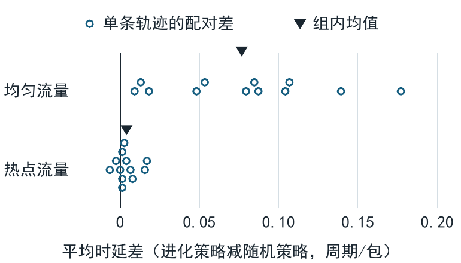

# 突发流量下片上网络源端注入顺序对包时延的影响

**摘要**　在固定路由的 4×4 片上网络中，同周期释放的一批包可以按不同顺序注入。本文在均匀、热点两类流量上分别重放 12 条留出轨迹，以包从释放到送达的平均时延评价四种源端策略。与先到先服务（FIFO）相比，进化搜索选出的策略在两类负载上平均分别节省 0.245 和 0.311 周期/包。与等预算随机搜索选出的策略相比，它平均分别多用 0.077 和 0.004 周期/包。这组有限突发仿真支持源端重排的平均收益，未观察到采用进化搜索选择权重带来的额外收益。

## 1　研究问题

节点同时产生多个包，首跳队列的积压和各包的路径长度便可能影响发送次序的选择。Yan 等研究了有任务依赖的片上多处理器系统，通过静态映射与调度优化应用完成时间等目标。这里固定源、目的地和 XY 路径，只改变源端每周期选哪个包发送。第一个假设是，进化搜索选出的评分规则在两类负载上都比 FIFO 缩短平均时延。第二个假设进一步要求，在评估相同数量的候选权重时，进化选出的规则在两类负载上也都优于随机搜索。另设无需训练的固定评分规则，用以衡量离线搜索比简单重排多带来多少收益。[Yan 等，ICAPS 2020](https://cdn.aaai.org/ojs/6675/6675-40-9904-1-10-20200521.pdf)

## 2　模型与比较方法

每个包占一个传输单位，先沿横向再沿纵向路由。每周期先释放新包，各源最多注入一个包，随后每条非空有向链路发送一个队首包。包在下一周期送达或进入后继链路队列。同周期到达同一队列的转发包按包 ID 入队。各输出队列容量无限，接收端可同时接收来自不同链路的包。16 个节点均从空网开始，于第 0、5、…、55 周期各释放 4 个包，每条轨迹共 768 包，全部送达后结束。均匀流量等概率选择其余 15 个节点。热点流量中，非热点源以 1/2 的概率直接选节点 5，其余情况均匀选目的地，故非热点源选中节点 5 的总概率为 8/15。节点 5 自身均匀选择其他节点。[仿真器与流量生成器](mesh.py)

FIFO 按释放次序发送。其余三种策略对每个待发包计算加权和，三项依次为已等待周期数、路径跳数和首跳队列当前包数，选得分最高者。各策略均用较小包 ID 打破平局。固定启发式的权重为 (1, 0, −1)。两种离线搜索在同一组 196 种整数权重上进行，第一项取 1 至 4，后两项各取 −3 至 3。两者使用种子 314159，首先评估相同的 6 个候选。随机搜索从余下权重中均匀抽取。进化搜索每批保留累计评分最好的 6 个候选，从与任一入选者恰有一项权重不同的未评估候选中再均匀抽取 6 个。每种方法共评估 24 组权重，在相同的 8 条轨迹上分别运行 192 次仿真。[搜索实现](experiment.py)

训练轨迹种子为 100–103（均匀）和 200–203（热点）。按 8 条轨迹的包时延总和取最小值，同分取字典序较小的权重。随机搜索选出 (4, −1, −2)，总时延 121538 周期。进化搜索选出 (1, −3, −3)，总时延 121683 周期。冻结权重后，各策略重放种子 1000–1011（均匀）和 2000–2011（热点）生成的轨迹。训练与测试的种子及轨迹哈希均无重叠，同一测试轨迹的四个策略使用相同的包 ID、释放时刻与源、目的节点。[候选权重及训练评分](results/search.csv)

## 3　留出结果

表 1 给出各策略的平均时延（周期/包）。每行包含 12 条轨迹，先将每条轨迹上全部包的“送达周期减释放周期”求和并除以 768，再对 12 个轨迹均值等权平均。该指标计入包在源端的等待。96 个测试运行均交付了全部 768 个包。[逐轨迹原始记录](results/paired.csv)

**表 1　四种源端策略在留出轨迹上的平均包时延（周期/包）**

| 负载 | FIFO | 固定启发式 | 随机搜索 | 进化搜索 |
| --- | ---: | ---: | ---: | ---: |
| 均匀 | 5.919 | 5.632 | 5.597 | 5.674 |
| 热点 | 31.851 | 31.697 | 31.536 | 31.540 |

表 2 在每条相同轨迹上计算“进化策略减对照策略”的时延差。均差和配对差的样本标准差均以周期/包计，负值表示进化策略较快。胜、平、负按逐轨迹差值的符号计数。[配对差、范围与计数](results/summary.csv)

**表 2　进化策略相对三种对照的配对时延差（周期/包）与胜平负轨迹数**

| 负载 | 对照策略 | 均差 | 配对差标准差 | 胜 / 平 / 负 |
| --- | --- | ---: | ---: | ---: |
| 均匀 | FIFO | −0.245 | 0.059 | 12 / 0 / 0 |
| 热点 | FIFO | −0.311 | 0.196 | 11 / 0 / 1 |
| 均匀 | 固定启发式 | +0.042 | 0.065 | 3 / 0 / 9 |
| 热点 | 固定启发式 | −0.157 | 0.191 | 10 / 0 / 2 |
| 均匀 | 随机搜索 | +0.077 | 0.052 | 0 / 0 / 12 |
| 热点 | 随机搜索 | +0.004 | 0.007 | 2 / 1 / 9 |

两表保留三位小数。配对差和标准差由逐轨迹记录直接计算后舍入。

进化策略在两类轨迹上的均值都低于 FIFO，支持第一个假设，但单条轨迹上有例外。热点种子 2008 上，进化策略与 FIFO 的总时延分别为 22172 和 22153 周期，配对差为 (22172 − 22153) / 768 ≈ +0.024740 周期/包。等预算比较不支持第二个假设。均匀轨迹上随机搜索选出的策略全部更快，热点轨迹上两者均值接近，进化策略只在其中两条更快。固定启发式在两类负载上也都降低了相对 FIFO 的平均时延，在均匀负载上也优于进化策略。

图 1 展开表 2 中两组等预算比较。均匀负载的差值全部位于零线右侧，热点负载的差值则聚集在零附近并跨过零线。均差同为正值，但两类流量的逐轨迹差异大小不同，热点负载还出现了方向相反的轨迹。

**图 1　等预算搜索选定的两种策略在留出流量上的平均包时延差。** 每个圆点对应一条轨迹上进化策略减随机策略的差值，单位为周期/包。负值表示进化策略更快，三角表示组内均值。每种负载有 12 条轨迹，点沿纵向错开以显示重叠的观测。[矢量图稿](paired-search-effects.pdf) · [由逐轨迹记录绘图的脚本](plot_search_effects.py)

## 4　结论与适用范围

在给定路径、固定突发间隔和这两组留出流量下，改变源端选包次序足以改变平均时延。本次重放观察到的 FIFO 差距不能归因于进化搜索算子。每种搜索只运行一个搜索种子，12 条独立测试轨迹衡量的是已选策略随流量变化的表现。要判断哪种选参方法更稳定，还需独立重复整个搜索过程。本模型在无限队列中按单个传输单位转发包。实验结论仅覆盖从空网到排空的包时延，有限缓冲和反压下的稳态吞吐及硬件实现代价尚待测量。

## 复核方法

归档时用 Python 标准库在 Windows（3.14.7）和 WSL Ubuntu 26.04（3.14.4）复核了路由与无争用时延、反向链路并行、源端注入上限、同链路争用和评分重排。另从零重跑训练和留出仿真，将两份生成的原始 CSV 与归档逐字节比对，并核对重算的汇总表。[两种平台的命令](README.md#重跑与回归) · [回归测试](test_mesh.py) · [配对统计脚本](analyze.py)
