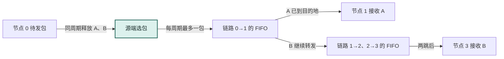

# 工程论文的图、表与最终版面

在设计章节、撰写结果或修稿时，先找读者必须完成的判断。例如，贡献是一种抗拥塞的源端调度规则，读者需要知道它在哪里作决定、能看到哪些状态、相对谁节省了多少等待。总览图可解释位置，时序图可解释一次决定，配对结果图可检验收益。按困难程度和证据决定是否分别绘制或组合成面板。一句话已能交代的参数留在正文；完整配置很多、作者需要复验时用表。[MIT 工程传播教学](https://mitcommlab.mit.edu/be/commkit/figure-design/)

## 按章节确定信息密度

列出本章的主要主张和最容易读错的关系。对尚未说明的结构、操作、比较或边界，在大纲旁记下“读者要回答的问题、最合适的表示、制图输入、正文将引用它的位置”。已有图表能承担这项任务就修改原图表。写到“显著优于”“解决瓶颈”时，要能定位到对应操作或对照及其条件。

通常可在系统或方法章优先展示系统边界、新机制所在位置和一次代表操作；在验证章优先展示测试边界、核心对照、代价及失效条件。证据丰富的一章可用多张图表，短章也可全用文字。相同数据若同时作图和制表，应分别完成读趋势和查精确数值等不同任务。全量明细、次要配置及大批同类波形可移至附录。定稿时从头连读图题、表题及正文引出句，查出缺图的核心判断、孤立插图和重复结果。

较长论文可使用[图表规划卡](../templates/figure-plan.md)，把动机、总览、机制操作、结果比较和边界诊断分别安排到需要它们的章节。动机图展示已有方案在什么条件下受限，机制图说明改变如何发生，数据图才承担实际效果的证据；不强制每类一张。有效信息密度取决于读者在最终尺寸下能辨认多少有用关系。先去掉装饰性容器、重复图例和无信息标签，安排读序、分面和局部放大，再考虑增减图表；不靠缩字或填满空白达标。

## 原创机制与实现图

| 读者的问题 | 建议绘制和核对的内容 |
| --- | --- |
| 创新位于何处 | 从接口、代码或设计规格重绘模块边界、外部输入、现有部件、改动点及输出。箭头注明对象和方向，例如“队首候选请求”“授予端口号”。控制与数据共图时分清线型。分层过多时用总图定位，再展开相关局部。[C4 表示约定](https://c4model.com/diagrams/notation) |
| 输入怎样变成输出 | 流程图覆盖开始、操作、判定、分支去向、终止或返回条件。拿一个代表输入走一遍，再用空队列、无可行候选等合法反例走另一条分支。图里出现的循环和退出条件须与伪代码一致。[ASQ 流程图](https://asq.org/quality-resources/flowchart) |
| 哪一拍发生了什么 | 标明时钟边沿、周期、有效信号和事务编号，画出真正被接受、等待或重试的位置。手工依据协议绘制的预期时序注明“规格示意”。若用于证明 RTL 行为，则由对应测试运行的波形或事务日志生成并留下可回查的周期。[WaveDrom 时序表示](https://wavedrom.com/tutorial.html) |
| 实物、台架或测量能证明什么 | 展示与方法有关的实际部件、探测点、观测窗口和图上可核验的条件。适用时给出已标定的比例尺。保留原始影像；裁切、增强及不同时段的拼接注明处理方式，分隔不同观察。示意图与实拍、实测信号分别标明。[Wiley 图像处理说明](https://blog.sciencenet.cn/home.php?do=blog&id=1535458&mod=space&uid=3411312) |

依据自己的接口和观测重绘优先。若机制依据既有文献，交代“依据何处、本文改在哪里”；若转载现有图，查实际许可、署名和目标刊要求。外部原图若承载证据，保留来源、图号、标尺与限制条件。换色、描边或重画同一布局不会产生新的工程贡献。[IEEE Access 插图重用说明](https://ieeeaccess.ieee.org/authors/preparing-your-article/)

多模块总览根据真实关系选串行流水、并行分支、双向交互或分层阶段。框名、接口对象和正文术语对应；训练/推理、数据/控制、测量/推导使用可辨识的编码。用[方法接口检查](engineering-argument.md#把方法说明写到接口)沿每条关键箭头走一遍，检查漏输入、错误方向和虚构串接。复杂图修订前列实际元素和关系清单，标出必须保留的用户文字与人工布局；只改指定部分，再检查新增遮挡和断边。

Mermaid 适合可清楚表达的流程与关系，draw.io 适合交互式结构编辑，绘图库适合数据图，电路/时序等采用相应专业工具。它们是可替换后端；先检查实际可用能力，不因选图而默认安装大环境。参考图复刻只在明确任务和素材使用范围内进行，保留必要来源，交代原生对象、嵌入图片和不可编辑部分；不能把裁切水印或栅格装入矢量容器当成原创可编辑图。

### 示例　选包决策怎样改变两个包的时延



**图　同源双包在固定 XY 路由中的注入与交付。** 节点 0 先从待发区选择一个包，A、B 均进入同一条首跳链路的 FIFO。A 一跳即交付，B 还要经过两条有向链路。两种策略只在“源端选包”处采用不同规则。图按仿真器的设定绘制，每条非空链路每周期服务一个包，转发包到下一周期才能使用下一跳。[模型实现](../dev/noc-smoke/mesh.py)

**用输入核对机制。** 在周期 0 先登记 A（0→1），再登记 B（0→3）。源端按 FIFO 选包，A、B 分别在周期 1、4 送达。改用评分权重（等待时间 1、路径跳数 1、首跳队深 0），B 先注入，A、B 分别在周期 2、3 送达。这是双包回归用例的仿真结果。两种情况下平均时延都是 2.5 周期/包；小图说明了决策位置与时延转移，正式负载上的平均收益还需另作对照。[对应测试](../dev/noc-smoke/test_mesh.py)

## 数据图、表与正文如何配合

- 同一单位上的多次方法比较，用逐对差值、成对点或确有意义的连接线体现设计。负载较多时按条件分面，尽可能共享坐标和指标定义。两种方法在同一批包上运行，一条轨迹可构成一个比较单位；误差条说明表示样本标准差、标准误还是具名方法的区间。包数、轨迹数、训练重复数各自注明。[配对数据示例](https://doi.org/10.1371/journal.pbio.1002128) · [分面布局](https://clauswilke.com/dataviz/multi-panel-figures.html)
- 负载、频率、时间等有自然次序的变量可以用折线表示趋势。连接同一个实验单位的两次观测时，图注说明配对关系。独立类别适合用点或柱。热图在图旁给量、单位和色标，正负差值可用以零为中心的发散色标。柱长编码绝对量时保留有意义的零点，局部差异可另绘差值。必要的对数轴、局部放大或不同面板尺度明确标出。颜色用于帮助辨识，同时通过线型、点形、位置或直接标签保留关键信息。最终尺寸下检查灰度与色觉差异。[颜色映射](https://matplotlib.org/stable/users/explain/colors/colormaps.html) · [冗余编码](https://clauswilke.com/dataviz/redundant-coding.html)
- 精确结果、方案取舍、参数预算宜保留可编辑表格。比较列写清可比条件、指标单位和差值方向，收益与代价分别可查；缺测、超时、不适用和真零分别表示，在表注解释。相同指标的有效精度一致，通用格式可对齐数字的小数位；目标刊规定居中、三线表或特定表头时按刊调整。表很宽时先按读者所问拆列组或转置；若必须跨页，使续表能辨认表名、列头和单位。[PLOS 表格说明](https://journals.plos.org/plosone/s/tables) · [表格与图注](https://clauswilke.com/dataviz/figure-titles-captions.html)
- 题注要使对象、必要条件、样本单位、符号和面板关系清楚；正文先引出问题，再点出关键比较、反例或限制。完整的筛选逻辑、区间计算和模型假设在方法节写清。长图注无法救回图中缺失的单位和不可辨的曲线。

**NoC 修稿例。** 若原稿仅写“图中显示进化算法总体更优”，从每种负载的 12 条独立留出轨迹重绘候选减基线的周期/包，画零差参考线，区分 FIFO 和同搜索预算的随机方法。题注可写“点为同一轨迹上两策略的平均包时延差。负值表示进化策略时延较低”。正文解读热点负载时可写“进化策略在 12 条轨迹中有 11 条快于 FIFO，但相对等预算随机搜索仅有 2 条更快，1 条持平，9 条更慢。”这样保留了源端重排的收益，也交代了优化器本身的证据边界。这个例子的数据见技能开发用例，运行新课题时应读取用户项目自己的原始结果。

若正文还需要精确比较，可配下面这张小表，把单位集中到表头。题注可写“热点负载的 12 条留出轨迹。每条轨迹对两个方法重放相同的包释放记录；标准差按轨迹差值计算”。图展示分布和反向轨迹，表承担精确查数，两者取舍取决于本章的判断。

| 热点负载下的对照 | 进化策略减对照的平均差（周期/包） | 配对差标准差（周期/包） | 快／平／慢（轨迹数） |
| --- | ---: | ---: | ---: |
| FIFO | −0.310547 | 0.195692 | 11／0／1 |
| 等预算随机搜索 | +0.004015 | 0.006855 | 2／1／9 |

## 按最终版芯制图

1. 读实际学校模板、学院指南、目标刊作者/图稿说明，分别记下单栏与跨栏的物理宽度、最小图内文字、线条、色彩或灰度、矢量/位图及表题格式。尚无具体刊名时沿用论文实际版芯，记录暂用尺寸。SCI、EI 收录情况无法替代某一刊物的图稿要求。
2. 同一物理栏宽下需要兼顾文字、数据和图例。图内正文字体在最终稿件中的点数约为“源图字体点数 × 嵌入宽度 ÷ 源图版面宽度”（等比缩放、裁切区与源版面一致）。例如 180 mm 宽图按 90 mm 嵌入，原 10 pt 约成 5 pt。先按终尺寸重新布局、共享图例或拆成多面板，必要时改用通栏。缩小轴注通常会先牺牲最关键的信息。
3. 曲线、文字和线图优先保存可编辑源文件并按刊导出矢量；照片与真实影像保留原始像素。有效 PPI 为实际像素宽度除以嵌入宽度的英寸数，裁切时用裁后像素。位图另存 PDF、调整 DPI 字段或事后上采样不会增加原始观测细节。[IEEE 尺寸与分辨率](https://journals.ieeeauthorcenter.ieee.org/create-your-ieee-journal-article/create-graphics-for-your-article/resolution-and-size/)
4. 独立图稿是 PDF 时，可用[图稿 PDF 检查工具](../scripts/check_figure_pdf.py)按预定刊载宽度核对可提取文字的缩放字号与内嵌位图。转曲字、图像内文字和复杂遮挡仍须目检。以最终排版导出的整页 PDF 或实际提交文件验收。根据页面物理尺寸核对图宽和最小文字，检查上下标、中文与数学字体替换、图例遮线、标签截断、交叉箭头、面板对齐、表头及灰度。结构检查、放大找缺字和按实际大小阅读各有用途；抽图或高倍放大可读不足以证明正文版面可读。编辑对象过密时先还原读序和层级，再决定分面、跨栏或移附录。最后从原始表复算至少一个核心图点或表格数值，核对题注、编号、正文、摘要与结论。

**不同出版方的实际例子。** IEEE Author Center 给出的常见栏宽为 88.9 mm 与 182 mm，建议全尺寸文字约 9–10 pt。Nature Research Figure Guide 的普通图字为 5–7 pt，面板字母另为 8 pt。《通信学报》公开图稿页给出半栏不超过 80 mm、通栏不超过 170 mm、图字 7.5 磅并要求适合黑白印刷。选择其一投递时核其最新具体模板，勿跨刊拼合参数。[IEEE 字体说明](https://journals.ieeeauthorcenter.ieee.org/create-your-ieee-journal-article/create-graphics-for-your-article/file-formatting/) · [Nature 图稿规范](https://research-figure-guide.nature.com/figures/preparing-figures-our-specifications/) · [《通信学报》稿件格式](https://www.joconline.com.cn/zh/info/15279/)

若本次按 88.9 mm 单栏制作、一页 PDF 仅包含该图、终版图字以 9 pt 为目标，可在图稿所在目录执行下例。解释器和技能目录见[平台说明](platforms.md)。传入稿件中实际放置的宽度。更换模板后替换相应参数，仅测量时可省略最小值，并可用 `--min-image-dpi` 指定该类图像的栅格门槛。

```text
python "<技能目录>/scripts/check_figure_pdf.py" figure.pdf --placed-width-mm 88.9 --min-text-pt 9
```

工具使用 PyMuPDF，按页面旋转方向、裁切边界和最终栏宽计算。遇到纵横缩放不一致等导致两种文字提取结果无法确认同一字号的情况，报告会给出待目检的文字段数，同时保留其余可测文字的最小字号。退出码 0 表示已执行的数值检查通过，1 表示实测值低于给定门槛，2 表示输入或环境问题，3 表示有指定项目无法测量且其余实测项均通过。若已知是无字线图，省略字号门槛即可。含位图文字、转曲标签、图内剪裁路径或局部遮挡时，按排版成品的实际大小目检。[PyMuPDF 文字提取说明](https://pymupdf.readthedocs.io/en/latest/functions.html#Page.get_texttrace)

## 图表版本与排版问题回查

每张核心图表保留稳定资产 ID、可编辑源、实际导出文件和稿件插入位置。数据图登记输入数据、过滤/统计口径、绘图脚本及版本；机制图登记设计/代码/规格及对应关系。外部数据、原图、改绘与本次真实运行分别标注来源身份。绘图输入变化会使原导出图、题注和依赖主张待重核；排版缩放变化则至少重核字号、线条、裁切和布局。可沿[证据记录](evidence-ledger.md)维护身份与依赖，不要求每张小示意图都建立独立目录。

| 现象 | 优先回查 |
|---|---|
| LaTeX 表字比正文异常小 | 源字号、`resizebox` 等缩放与嵌入宽度是否叠加；先拆列组或调版式，再按实际模板选字号。 |
| 长表后大片空白或续表难读 | 浮动/分页约束、表后间距（如 `LTpost`）、续页表头和单位；只在定位原因后局部修改。 |
| 题注/目录不一致 | 双语题注和短标题参数、子图/续图编号、模板 class 与实际编译结果；不全局替换类似命令。 |
| Word 中图题孤立、表中文字裁切 | 段落分页控制、固定行高、单元格边距、图形环绕与字体替换；检查目标文档导出的页面。 |
| 表格高亮与正文“最佳”不符 | 指标方向、是否同协议、并列结果、精度舍入、误差与实际比较判据；粗体不能制造统计显著性。 |

验收分别记可编辑结构、数值比对、真实导出和最终版面阅读的结果。仅检查 SVG/XML/对象坐标不代表视觉已通过；看图的视觉工具也不能替代原数据复算。图内标签、题注与正文引图句各有作用；表注须解释统计符号、缺测和计数口径。Word/LaTeX 的构建和最终文件验证见[文档工作流](document-workflows.md)。
